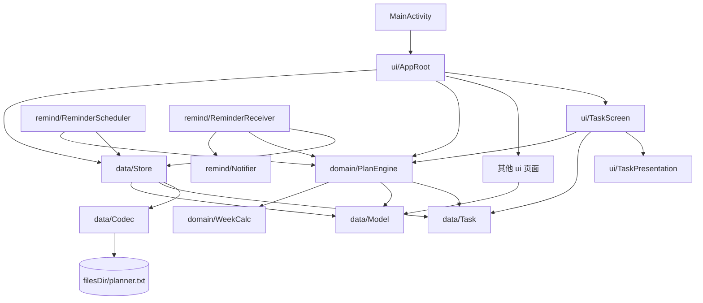

# DeadlineReminder 模块目录与修改影响地图

本文面向维护者与编码代理：**不读具体实现，也能判断一个改动应从哪里开始、会影响哪些模块、需要补哪些测试**。

## 一、依赖方向



硬约束：

1. `domain/` 是纯 Kotlin 计算层，不得依赖 Android API，必须能跑 JVM 单测。
2. `ui/` 只收集输入、展示状态和转发操作，不直接读写 `planner.txt`，不复制排程规则。
3. `remind/` 从 `Store` 读取最新数据并调用 `PlanEngine`，不能维护第二份任务真相。
4. `data/Codec.kt` 只负责格式兼容，不决定任务是否可排、是否紧急。
5. 任务字段只在 `Task` 定义一次；排程、UI、提醒都引用同一模型。

## 二、当前可达界面

实际入口链路：

```text
MainActivity → AppRoot → TaskScreen / CalendarScreen / SettingsScreen
```

- `TaskScreen.kt` 是默认首屏，负责今日课程摘要、任务列表、任务编辑弹窗。
- `ScheduleScreen.kt` 当前没有从 `AppRoot` 接线，仅保留为历史时间线实现参考。修改它不会改变当前首屏，但它仍参与编译，公共组件签名变化时必须同步。
- `AppRoot.kt` 持有 Compose 内存态，任务、课程、设置改变后触发重算与提醒重排。

## 三、模块职责与禁止越界

| 文件或目录                     | 负责什么                                         | 不负责什么             | 直接依赖者                                   |
| ------------------------------ | ------------------------------------------------ | ---------------------- | -------------------------------------------- |
| `data/Task.kt`                 | 任务字段、时间解析、重要度与紧急度派生           | 落盘、排程、界面       | Codec、Store、PlanEngine、UI、提醒           |
| `data/Model.kt`                | 课程、设置、作息、调休模型                       | 任务状态与通知         | Store、WeekCalc、PlanEngine、UI              |
| `data/Codec.kt`                | `planner.txt` 行格式编解码、旧数据默认值         | 业务校验、自动修复依赖 | Store、CodecTest                             |
| `data/Store.kt`                | 内存态、同步落盘、任务 CRUD、每日任务 04:00 复位 | 计算工作块、展示 UI    | AppRoot、全部提醒接收器                      |
| `domain/WeekCalc.kt`           | 教学周、单双周、调休、课程发生时间               | 任务排序               | PlanEngine、课程 UI、课程提醒                |
| `domain/PlanEngine.kt`         | 空档、任务约束、工作块、可行性                   | Android 闹钟、文件 IO  | AppRoot、ReminderScheduler、ReminderReceiver |
| `ui/AppRoot.kt`                | 页面接线、状态刷新、保存后重排                   | 具体排程算法           | MainActivity                                 |
| `ui/TaskScreen.kt`             | 任务排序展示、编辑、依赖选择、状态文案           | 直接落盘、创建闹钟     | AppRoot                                      |
| `ui/TaskPresentation.kt`       | 摘要状态优先级、紧急标签与高红判定               | Compose 布局、排程     | TaskScreen、JVM 展示测试                     |
| `remind/ReminderScheduler.kt`  | 把课程和工作块转换为 AlarmManager 闹钟           | 判断任务业务真相       | AppRoot、BootReceiver、Receiver              |
| `remind/ReminderReceiver.kt`   | 响铃时重读数据、校验计划、组装通知内容           | 长期缓存旧计划         | AlarmManager                                 |
| `remind/TaskActionReceiver.kt` | 通知按钮登记进度或完成任务                       | 自己修改文件格式       | Notifier                                     |
| `remind/Notifier.kt`           | 渠道、通知样式与动作按钮                         | 排程、持久化           | ReminderReceiver                             |
| `ocr/`                         | 图片识别与课表/作息/校历解析                     | DDL 任务排程           | ImportScreen                                 |

## 四、任务数据格式

`planner.txt` 首行仍为 `v2`。任务记录为制表符分隔的 `T` 行：

| 索引 | 字段              | 缺失时默认值   |
| ---: | ----------------- | -------------- |
|    0 | `T`               | —              |
|    1 | `id`              | 缺失则整行跳过 |
|    2 | `title`           | 空字符串       |
|    3 | `courseName`      | 空字符串       |
|    4 | `estimateMinutes` | `60`           |
|    5 | `spentMinutes`    | `0`            |
|    6 | `deadline`        | 空字符串       |
|    7 | `priority`        | `1`（中）      |
|    8 | `notes`           | 空字符串       |
|    9 | `done`            | `false`        |
|   10 | `createdAt`       | 空字符串       |
|   11 | `chunkMinutes`    | `-1`           |
|   12 | `daily`           | `false`        |
|   13 | `completedOn`     | 空字符串       |
|   14 | `earliestStart`   | 空字符串       |
|   15 | `dependencyIds`   | 空列表         |
|   16 | `estimateUnknown` | `false`        |

格式规则：

- **只能向行尾追加字段，不得重排或复用旧索引。**
- 新字段必须有安全默认值，并在 `CodecTest` 同时覆盖完整往返与旧行解码。
- `dependencyIds` 存任务 ID，不存标题；标题可编辑，ID 才是稳定引用。
- 删除任务时由 `Store.deleteTask` 清理其他任务对它的引用。
- 新版数据被旧版应用写回时，旧版不认识的尾部字段会丢失；不支持降级写回保留新字段。

## 五、排程规则与连锁反应

`PlanEngine.build` 的输入是设置、课程、任务和显式 `now`，输出 `Plan`：

1. 已完成、剩余工作量为零、已过期的任务不进入工作块分配。
2. `earliestStart > now` 时整件任务暂不参与排程，状态为 `NOT_STARTED`；到点重算后加入。
3. 任一现存前置任务未完成时状态为 `BLOCKED`；只有前置任务实际完成才解锁。
4. 有截止任务先按截止时间排序；同截止时间按重要程度、创建时间、标题稳定排序。
5. 无截止任务排在有截止任务之后，在 14 天滚动窗口内按重要程度和创建时间排程。
6. 无截止任务有工作块和时段提醒，但没有 DDL 预警、紧急、截止三级提醒。
7. 紧急程度由“截止前可用分钟 ÷ 剩余分钟”与 `priority` 共同决定；重要任务更早进入关注或紧急状态，但远期高重要任务不能压过即将到期任务。
8. `daily` 只控制跨日复位，不代表“不排程”；无截止的每日任务正常参与滚动排程。
9. `estimateUnknown` 表示长期任务暂时无法准确估时：不占工作块、不产生时段提醒，但保留截止时间和 DDL 三级提醒。
10. 任务摘要先显示 `NEEDS_ESTIMATE / NOT_STARTED / BLOCKED` 等不可执行原因，再计算紧急度；只有“高重要且紧急”进入高红状态，单纯紧急只用琥珀提示。
11. 每日任务以本地凌晨 04:00 为任务日边界；00:00–03:59 完成时仍记录到前一个任务日。普通已完成任务不自动删除。

修改排程规则时必须同步检查：

- `PlanEngineTest.kt`：纯逻辑行为。
- `TaskScreen.kt`：列表顺序、状态和解释文案。
- `ReminderScheduler.kt`：哪些工作块会变成闹钟。
- `ReminderReceiver.kt`：旧闹钟触发时是否仍能通过最新计划校验。
- `docs/SPEC.md`：用户可观察行为。

## 六、按需求定位修改入口

| 想修改的行为       | 第一修改入口                                          | 必须联动检查                                                           | 漏改后果                            |
| ------------------ | ----------------------------------------------------- | ---------------------------------------------------------------------- | ----------------------------------- |
| 新增或删除任务字段 | `data/Task.kt`                                        | `Codec.kt`、`TaskEditDialog`、`CodecTest`、备份兼容                    | 字段不落盘或恢复后丢失              |
| 改任务依赖语义     | `domain/PlanEngine.kt`                                | `Store.deleteTask`、`TaskScreen` 环检测、提醒校验、测试                | 永久阻塞、循环依赖或旧闹钟误报      |
| 改最早开始行为     | `PlanEngine.build`                                    | `TaskScreen` 排序/文案、提醒、`PlanEngineTest`                         | UI 说等待但后台仍排程               |
| 改重要程度或紧急度 | `data/Task.kt::urgencyFor` / `ui/TaskPresentation.kt` | `PlanEngine` 排序、`TaskScreen` 颜色/标签、展示测试                    | 展示与实际安排不一致或滥用高红      |
| 改耗时未知语义     | `data/Task.kt` / `domain/PlanEngine.kt`               | Codec、TaskEditDialog、Scheduler、展示状态、测试                       | 长期任务被默认时长污染排程          |
| 改无截止任务策略   | `PlanEngine.build`                                    | `Feasibility.NO_DEADLINE` 文案、Scheduler、Digest、SPEC                | 能排但界面仍说不能排                |
| 改每日任务复位     | `Store.taskDayAt` / `refreshDailyTaskStates`          | `addSpent`、`setTaskDone`、AppRoot、Scheduler、Receiver、DailyTaskTest | 凌晨刚完成就复活，或 04:00 后不出现 |
| 改任务列表顺序     | `TaskScreen.sortedTasks`                              | 与 `PlanEngine` 排序意图核对                                           | 看起来优先但实际工作块相反          |
| 改工作块切分       | `PlanEngine.build`                                    | session 通知登记分钟、每日上限、PlanEngineTest                         | 通知登记量与真实计划不符            |
| 改课程占用         | `WeekCalc.kt`                                         | PlanEngine 空档、课程提醒、周课表测试                                  | 排程与上课时间重叠                  |
| 改任务保存流程     | `AppRoot.persistTasks` / `Store`                      | ReminderScheduler 重排                                                 | UI 更新但磁盘或闹钟仍旧             |
| 改提醒时机         | `ReminderScheduler.kt`                                | Receiver、Notifier、Manifest、系统权限                                 | 闹钟存在但不发通知，或无法重建      |
| 改通知按钮         | `Notifier.kt`                                         | `TaskActionReceiver.kt`、PendingIntent 唯一性、Store                   | 点按钮操作错任务或不重排            |
| 改设置字段         | `data/Model.kt`                                       | Codec 的 `S` 行、SettingsScreen 草稿、设置测试                         | 设置重启后恢复默认                  |
| 改首页内容         | `ui/TaskScreen.kt`                                    | `AppRoot.kt` 参数与状态                                                | 修改未接线页面而无可见效果          |
| 改 OCR 导入        | `ocr/` 对应解析器                                     | ImportScreen、解析器测试、应用确认步骤                                 | 识别结果未写入真实课程/设置         |

## 七、新功能实施顺序

跨模块功能按以下依赖顺序修改，避免界面先引用不存在的数据：

```text
规格与验收条件
  → Task / Model 数据契约
  → Codec 向后兼容
  → Store 写入与状态迁移
  → PlanEngine / WeekCalc 纯逻辑
  → AppRoot 状态接线
  → TaskScreen / SettingsScreen 展示与输入
  → ReminderScheduler / Receiver / Notifier
  → JVM 测试、构建、lint、真机验证
```

推荐验证命令：

```text
./gradlew :app:testDebugUnitTest :app:assembleDebug :app:lintDebug
```

逻辑修改至少要有 JVM 测试；通知投递、AlarmManager 精确性、日期/时间选择器与滑动交互仍需真机验证。

## 八、关键测试地图

| 测试文件                    | 保护范围                                                                   |
| --------------------------- | -------------------------------------------------------------------------- |
| `PlanEngineTest.kt`         | 空档、上课占用、每日上限、截止排序、重要度、无截止、依赖、最早开始、可行性 |
| `CodecTest.kt`              | `planner.txt` 往返、旧字段默认值、损坏行容错                               |
| `DailyTaskTest.kt`          | 每日任务 03:59 / 04:00 边界、跨任务日复位的纯状态逻辑                      |
| `TaskPresentationTest.kt`   | 等待状态覆盖紧急度、待估时标签、只有双条件命中才高红                       |
| `WeekCalcTest.kt`           | 教学周、单双周、调休与课程发生时间                                         |
| `SettingsValidationTest.kt` | 设置输入边界                                                               |
| OCR 三组测试                | 课表、作息、校历解析                                                       |

## 九、修改完成检查清单

- [ ] 新字段只追加到 Codec 行尾，旧数据仍能读取。
- [ ] UI 展示规则与 `PlanEngine` 结果一致，没有复制一套判断。
- [ ] 数据修改后同步落盘，并调用提醒重排。
- [ ] 每日任务通过“完成”和“登记满时长”两条路径都记录 `completedOn`。
- [ ] 下一次 04:00 维护闹钟已注册且不受普通提醒数量截断；前台恢复能补偿系统延迟。
- [ ] 删除前置任务后没有悬空依赖。
- [ ] 无截止任务只有时段提醒，不生成 DDL 三级提醒。
- [ ] 最早开始未到或依赖未满足时，不生成工作块和时段提醒。
- [ ] 预计耗时未知时不生成工作块和时段提醒，但保留已有截止时间的 DDL 提醒。
- [ ] 高红只用于高重要且紧急任务，等待类状态和单维度风险不使用红色。
- [ ] 定向测试、全量单元测试、Debug 构建和 lint 均通过。
- [ ] 若声称通知或交互可用，已在真机验证；否则明确写入验证边界。
